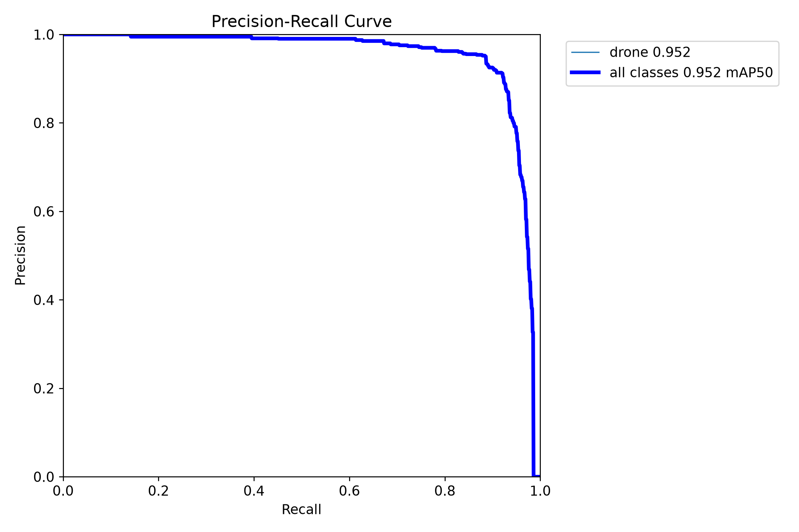
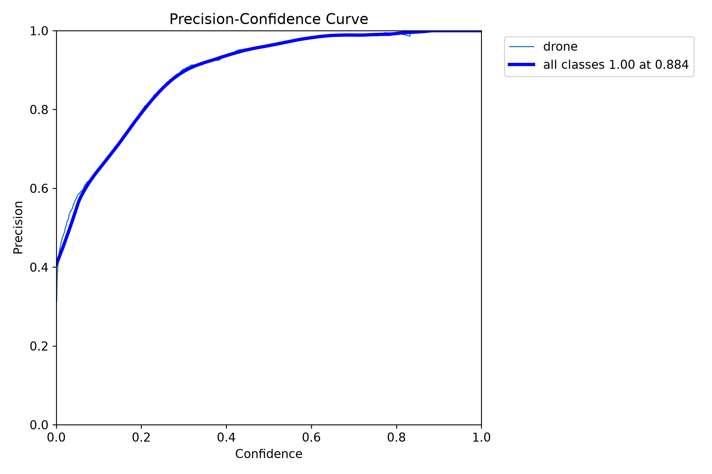

# Sistema de detección y predicción de trayectoria de drones (YOLO 26).

Dado un video (cámara, stream de red o archivo), el sistema detecta objetivos con un modelo YOLO, les asigna un identificador persistente, filtra el ruido de su posición con un filtro de Kalman, estima su velocidad, aceleración y velocidad angular, decide qué modelo de movimiento describe mejor su comportamiento (velocidad constante, aceleración constante o giro coordinado) y dibuja en pantalla la posición futura esperada con su zona de incertidumbre.
El sistema solo predice la posición futura del objetivo. No calcula geometrías de intercepción ni ningún otro elemento ajeno a la predicción, como se estableció en las consideraciones de la investigación.

# Datasets utilizados.

Para entrenar el modelo de predicción, se utilizaron Datasets públicos de Kaggle. Créditos y referencias a los que correspondan.

- dasmehdixtr: 
    [Drone Dataset (UAV)](https://www.kaggle.com/datasets/dasmehdixtr/drone-dataset-uav)

- kaizen: 
    [Drone Object Detection](https://www.kaggle.com/datasets/sshikamaru/drone-yolo-detection)

# Resultados.

_Poner videos..._

# Ejecución del código.

Antes de ejecutar se deben instalar las dependencias. Estas se pueden encontrar en _requirements\base.txt_

## Ejecución con webcam de la laptop

Ejecuta el siguiente comando en la terminal:

    python target_trajectory_prediction.py --weights ..\models\yolo_m_drone_v1.pt --source 0

## Ejecución con una camara conectada mediante IP.

1. Descargar la app **IP Webcam** para conectarnos mediante nuestro celular.
2. Conectar a la misma red nuestro celular y laptop (mediante un Access Point/WAP).
3. Iniciar la aplicación, eliminamos la contraseña y el usuario requeridos. Iniciamos el servidor. Comprobamos su conexión mediante un *ping*.
4. Ejecutamos el siguiente comando en la terminal:

Ej:

    python target_trajectory_prediction.py --weights ..\models\yolo_m_drone_v1.pt --source "http://x.x.x.x:8080/video"

*Solo cambia la IP por la que tengas en el servidor*.

## Notas.
Para todos los casos anteriores, podemos añadir "--output salida.mp4" sin las comillas para generar una salida de video. 

**Controles**
- q: Cierra el programa.
- r: Reinicia el seguimiento.
